  
  
  

I'm a Machine Learning Engineer and software builder in Chicago, pursuing an M.S. in Computer Science at UIC and an M.S. in Computer Engineering at Politecnico di Torino.

I work from ML research to production: clinical speech models, data pipelines, LLM agents, and the infrastructure that serves them, with an emphasis on rigorous evaluation and dependable engineering.

## Selected work

- **[DivvyAI](https://www.nickvivarelli.com/projects/divvyai)** — a live Google Cloud pipeline that records Chicago's Divvy bike-share feeds every 15 minutes, models them with dbt in BigQuery, and serves a hosted AI agent over a read-only MCP server. Scored **95%** on a SQL-verified benchmark and **98%** on a prompt-injection evaluation. **[Live](https://divvyai.bike) · [Code](https://github.com/nicolavivarelli01/DivvyAI-Public)**
- **[Alzheimer's detection from speech](https://www.nickvivarelli.com/projects/mci)** — Wav2Vec2 and Llama 3.2 with LoRA, studying whether pretraining on one clinical speech dataset transfers to another. **85.0% accuracy** and **0.954 AUROC** on the PROCESS-2 test set (healthy vs. impaired); LoRA beat the frozen model in 12 of 12 paired runs on ADReSS. **Ongoing at UIC.**
- **[SignalBrief](https://www.nickvivarelli.com/projects/signalbrief)** — inbox intelligence that ranks what deserves attention each morning, with evaluated ranking baselines and reconstructable PostgreSQL decision lineage. **In development.**
- **[Autism evaluation research](https://www.nickvivarelli.com/projects/autism-reimbursement)** — leakage-controlled healthcare ML across 214 decisions from 72 social workers, paired with evidence-grounded LLaMA explanations. **Active research.**
- **[Postoperative complication prediction](https://www.nickvivarelli.com/#project-clinical-ml)** — published deep-learning work ([paper](https://doi.org/10.1007/s10151-025-03165-9)) on 2,013 multicenter patient records, reaching **0.86 accuracy** and **0.94 AUC**.

**Now building:** [LoRAplex](https://loraplex.com), a multi-tenant LoRA serving platform on AWS EKS with vLLM, measuring when adapter-aware routing beats round-robin on latency and cost.

**Stack:** Python · PyTorch · Hugging Face Transformers · TensorFlow · scikit-learn · Google Cloud (Cloud Run, BigQuery) · dbt · PostgreSQL · Docker · Terraform · AWS (IAM, S3, EKS)

DivvyAI's code is [public](https://github.com/nicolavivarelli01/DivvyAI-Public). My clinical research stays private under data-use agreements; I share its architecture, evaluation, and design decisions through case studies on [my site](https://www.nickvivarelli.com).
